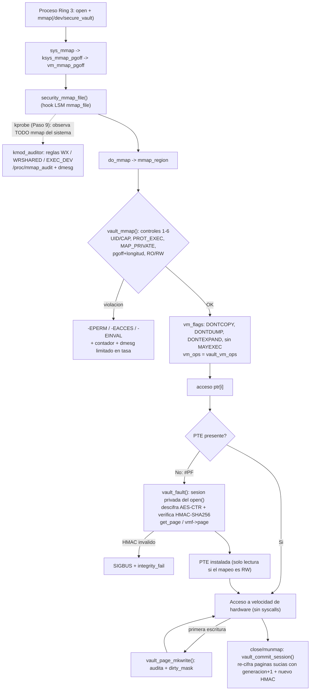

# Parte II — Estrategia con IA (30 %)

> Esta parte documenta **cómo se usó la IA y cómo se verificó**. Todo lo que se afirma como hallazgo tiene un comando que lo reproduce (§5) y su salida en [`evidencia/`](./evidencia/).

---

## 1. Flujo de trabajo asistido por IA (roles por fase)

| Fase | Rol de la IA | Rol humano / verificación | Producto |
|---|---|---|---|
| **Exploración arquitectónica** | Leer el plan, el PDF del parcial y el repositorio; mapear `vm_area_struct`, `vm_operations_struct`, hooks LSM/kprobes; proponer alternativas (syscall hook vs LSM vs eBPF) | Contrastar **cada nombre de función/flag** con los headers reales de 6.19.10 y 7.2.13 (no con la memoria del modelo) | `PARTE_I_respuestas.md` (marcas `[H]`/`[E]`/`[F]`) |
| **Generación y revisión de código C** | Primer borrador del módulo `secure_vault` (open/mmap/fault/page_mkwrite/ioctl), de la capa crypto, del auditor kprobe y de las pruebas | Compilar con `-Wall -Wextra -Werror` contra **dos** kernels; revisar contrato de bloqueos (`session->lock → vault_lock`), refcounts (`get_page`/`put_page`) y rutas de error (`goto err_*`); **ejecutar** en VM | `paso9_*`, `paso10_*` |
| **Casos de prueba y PoC controlados** | Escribir ataques (UID no autorizado, fd heredado, `PROT_EXEC`, `MAP_PRIVATE`, offset OOB, carrera `madvise` + `/proc/self/mem`, manipulación de integridad) | Ejecutar **solo contra el módulo propio** en una VM desechable; verificar que las pruebas *pueden fallar* (prueba de mutación, §4) | `tests/`, `vm/`, `docs/evidencia/` |

**Principio:** la IA acelera la exploración y el primer borrador; **nada se acepta sin compilar, ejecutar y, cuando importa, intentar romperlo** (mutación).

---

## 2. Ingeniería de prompts

### 2.1 Prompt real de esta sesión

| # | Fase | Rol | Contexto | Restricción | Resultado esperado | Resultado real | Corrección humana / de verificación |
|---|---|---|---|---|---|---|---|
| 1 | Implementación end-to-end | Agente de ingeniería con acceso a shell (Claude Code) | Plan de acción `PLAN_DE_ACCION_P3.md`, PDF del parcial, repo `CapaKernel_Proyecto3` (README, pasos 1-8) | "Ejecuta el plan de acción **de manera ordenada, estructurando todo por carpetas**; al final un `.md` con el resumen y el paso a paso" | Módulo endurecido + tests + métricas + informes en carpetas | Ver `RESUMEN_IMPLEMENTACION.md`. El entorno **no tenía** `kernel-devel` ni `sudo` ⇒ el agente obtuvo headers sin root (`dnf download` + `rpm2cpio`) y montó una **VM QEMU/KVM** para cargar módulos con seguridad | Se detectaron y corrigieron **errores del propio plan** (§3 F1–F4) al contrastar con el kernel real |

### 2.2 Prompts del borrador previo (`Parcial_CapaKernel_Solucion.md` §3.2) — *no verificados aquí*

| # | Rol | Restricción | Estado |
|---|---|---|---|
| 1 | Ingeniero de kernel senior | Solo APIs 6.x, citando header | Reutilizable; ahora respaldado por [`alucinaciones_compilacion.txt`](./evidencia/alucinaciones_compilacion.txt) |
| 2 | Experto en eBPF/kprobes | Sin asumir `CONFIG_BPF_LSM` | Cumplido: Paso 9 usa kprobe clásico `[E]`; BPF-LSM queda como trabajo futuro (la config **sí** lo permite `[H]`) |
| 3 | Auditor ofensivo controlado | Sin payload de escalada | Cumplido: `test_race_madvise.c` ataca solo `/dev/secure_vault` |
| 4 | Ingeniero de performance | Solo `perf`/`strace -c`/`getrusage` | **Parcial**: `perf`/`strace` no están instalados en este entorno; se usó `getrusage`, `ktime` en kernel y **ftrace** (`bench/run_overhead.sh` los usa si existen) |

### 2.3 Plantilla para los prompts propios del equipo (**completar**: mínimo 4)

| # | Fase | Rol | Contexto | Restricción | Resultado esperado | Resultado real | Corrección humana |
|---|---|---|---|---|---|---|---|
| 2 | *(completar)* | | | | | | |
| 3 | *(completar)* | | | | | | |
| 4 | *(completar)* | | | | | | |

---

## 3. Registro de errores y "alucinaciones" **reales** encontrados y corregidos

Cada fila es un hallazgo comprobado en esta sesión (no hipotético). La columna *Origen* indica de dónde vino la afirmación errónea.

| # | Afirmación incorrecta / riesgosa | Origen | Cómo se detectó | Qué pasa realmente | Corrección |
|---|---|---|---|---|---|
| **F1** | "Exigir `VM_SHARED` y rechazar `MAP_PRIVATE`" | Plan §3.1 (#4) | Mutante M8: poner `VM_SHARED` hace fallar **6** pruebas | Para `MAP_SHARED` sobre fd sin `FMODE_WRITE` el core **limpia `VM_SHARED`**; hay que usar **`VM_MAYSHARE`** | `vault_mmap` usa `VM_MAYSHARE` |
| **F2** | "El Paso 4 ignora `vm_pgoff` ⇒ posible mapeo **fuera del buffer**" | Plan §2 | `attack_matrix`: A5/A6 PERMITIDO (offset ignorado), pero **A9 BLOQUEADO** (el límite de tamaño sí funciona) | El defecto real es **aliasing de offset** (pedir offset 1 MiB devuelve el inicio del buffer), no lectura fuera de rango | Control 5 valida `pgoff`+longitud; `test_oob_pgoff` + mutante M1 |
| **F3** | "`vm_flags_clear(VM_WRITE\|VM_MAYWRITE)` hace fallar el `mprotect(PROT_WRITE)`" | Plan §3.1 (#3) | Mutante M6 **sobrevive** (72/72) | El core ya hace eso para `MAP_SHARED` de un fd de solo lectura ⇒ control **redundante** | Se conserva como defensa en profundidad; se documenta como redundante |
| **F4** | "`kallsyms_lookup_name` / `sys_call_table` se pueden usar desde un LKM" | Patrón típico de IA (plan §3 opción B) | `verificar.sh` (H1, H2): `modpost: "sys_call_table" undefined!` | No están exportados a módulos | Opción B descartada; se usa LSM-hook observado por kprobe |
| **F5** | "Apagar `CR0.WP` con `write_cr0` para escribir en la tabla" (práctica insegura citada en el enunciado) | Patrón típico de IA | H5 en VM: `CR0 antes=0x80050033 después=0x80050033` + `CR0 WP bit went missing!?` | El kernel **fija** `CR0.WP`; la técnica ni funciona ni es segura | No se usa; documentado en Parte I Q4 |
| **F6** | `vma->vm_flags \|= …` (código "clásico") | Patrón típico de IA | H3: `error: assignment of read-only member 'vm_flags'` en 6.19 **y** 7.2 | Desde 6.3 hay que usar `vm_flags_set/clear` | Macro `vault_vm_flags_set/clear` con guarda de versión |
| **F7** | `class_create(THIS_MODULE, name)` (firma antigua) | Patrón típico de IA / código base | H4: `incompatible pointer type` | Desde 6.4 es `class_create(name)` | Macro `vault_class_create`; `paso8` corregido |
| **F8** | "`kmap_atomic()` ya no existe (≥ 5.11)" | Borrador previo | H6: **compila y enlaza** en 6.19 y 7.2 | Está **obsoleta**, no eliminada; lo vigente es `kmap_local_page()` | Matiz corregido en Parte I (C7); la bóveda no usa kmap (memoria baja) |
| **F9** | "`mm->mm_rb`/`mm->mmap` (lista)" | Borrador previo Q1 | `grep` en `mm_types.h` 6.19: solo `mm_mt` (maple tree) | Cambió en 6.1 | Parte I Q1 corregida |
| **F10** | `paso8` "clean build" | Repo | `-Wformat`: `%d` con `unsigned long` | Un warning rompe el requisito "sin advertencias" | Corregido + `-Werror` en el Makefile de paso8 |
| **F11** | Compilar en la carpeta `parcial 3` | Entorno | `kbuild: specified external module directory "/home/sb/Desktop/SO/parcial" does not exist` | kbuild **no soporta espacios** en la ruta | `run_vm_tests.sh` compila en un espejo sin espacios; el Makefile lo advierte |
| **F12** | `<linux/unaligned.h>` / `crypto_memneq` en `<crypto/utils.h>` | Código propio | Verificado que existen en 6.19 y 7.2; en kernels < 6.12 estaban en `<asm/unaligned.h>` / `<crypto/algapi.h>` | Cabeceras que se movieron | `__has_include` (la rama antigua **no se pudo compilar aquí**) |
| **F13** | Macro `vault_stat_inc(write ? a : b)` | **Error propio** | El compilador: `has no member named 'write'` | La macro concatena un identificador, no evalúa expresiones | Reescrito con `if/else` |
| **F14** | Prueba `test_tamper`: el hijo tocaba el mapeo del padre y esperaba `SIGBUS` | **Error propio** (detectado por razonamiento) | Con `VM_DONTCOPY` el hijo no hereda la VMA ⇒ habría dado `SIGSEGV`, no `SIGBUS` | El aislamiento por `fork` funciona (y por eso la prueba era incorrecta) | El hijo abre y mapea por sí mismo |
| **F15** | `munmap` costaba 11 µs en la primera medición | Diseño propio | Benchmark inicial | Se recalculaba HMAC de todas las páginas en cada cierre aun sin escrituras | Máscara `dirty_mask` alimentada por `page_mkwrite`: `munmap` 11,3 → 2,2 µs en esa corrida |

---

## 4. Procedimiento de validación (qué se hizo y cómo reproducirlo)

1. **Compilación contra headers reales**, no contra memoria del modelo: `vm/check_compat.sh` compila los 6 módulos del repo contra **6.19.10 y 7.2.13** → 12/12 OK, 0 warnings de código (`evidencia/compat.txt`). Módulos con `-Wall -Wextra -Werror`, pruebas de usuario con `-Werror`.
2. **Ejecución real en el kernel 6.19.10** dentro de una VM QEMU/KVM (`vm/run_vm_tests.sh`): **72/72 PASS** (3 repeticiones idénticas; `evidencia/tests.log`).
3. **Prueba de mutación** (`vm/mutation_test.sh`): se elimina un control por vez; **7/8 mutantes detectados**, 1 sobrevive (M6, redundante) → las pruebas *sí pueden fallar* (`evidencia/mutacion.txt`).
4. **Comparación antes/después** contra el Paso 4 sin endurecer (`evidencia/matrix.log`).
5. **Revisión línea a línea** del código generado, con foco en: orden de locks, `get_page`/`put_page`, liberación en `goto err_*`, `memzero_explicit` de material sensible, `copy_{to,from}_user` solo con punteros de usuario, y comprobación de **todos** los retornos de la crypto API.
6. **Aislamiento**: ningún módulo se cargó en el host; la VM es desechable (`-no-reboot`, `panic=-1`).


---

## 5. Cómo reproducir cada hallazgo

```bash
cd CapaKernel_Proyecto3
vm/check_compat.sh <KDIR-A> <KDIR-B>                 # F6, F7, F10: compilación en varios kernels
paso10_secure_mmap/verificacion_ia/verificar.sh <KDIR-A> <KDIR-B>   # F4, F6, F7, F8 (H1..H4, H6)
vm/run_vm_tests.sh halluc                            # F5 (CR0.WP, se ejecuta en la VM)
vm/run_vm_tests.sh matrix                            # F2
vm/mutation_test.sh                                  # F1, F3 (M8, M6) y controles 1-9
```

---

## 6. Arquitectura seleccionada



## 7. Matriz de compensaciones (medida, no estimada)

Mediana entre 6 arranques de VM (30 corridas × 2000 iteraciones por arranque); `evidencia/bench_resumen.txt`.

| Decisión | Seguridad (profundidad / cobertura) | Rendimiento medido | Complejidad / riesgo |
|---|---|---|---|
| Validación en `.mmap` (UID, W^X, `MAP_PRIVATE`, rango) | **Alta** sobre el recurso; no ve accesos posteriores | `mmap()` **0,41×** el del Paso 4 (2,8 µs vs 6,8 µs: no precarga PTEs con `remap_pfn_range`) | Baja |
| Descifrado + HMAC en `.fault` | **Alta** (confidencialidad e integridad *por página*) | Primer acceso a una página en la sesión: ~tens de µs bajo ftrace; **sesión completa (open+mmap+4 faults+munmap+close) 2,14×** (33 µs vs 15,5 µs) | Alta (crypto en contexto de proceso, locks) |
| Auditoría por página y `page_mkwrite` | **Alta** (cada página tocada / primera escritura) | Fault con página ya cargada ≈ **1,7 µs/fault (11,6× los 0,145 µs de PTE preinstalada)**; coste solo en el 1.er acceso | Media |
| `commit` (HMAC) solo con páginas sucias | Detección a posteriori de cambios autorizados | `munmap` **1,08×**; sin la `dirty_mask` era ~5× | Media |
| **Acceso con PTE instalada** | — | **1,00×** (0,5 ns = 0,5 ns): sin overhead en régimen estacionario | — |
| kprobe global (Paso 9) | **Amplitud** (todo `mmap` del sistema) pero **solo observa** | Pre-handler en cada `mmap`; `kprobe_nmissed=0` | Baja/Media (contexto atómico) |
| Hook de `sys_call_table` | Cobertura teórica global | — | **Inviable** (no exportada, `CR0.WP` fijado) |
| BPF-LSM (trabajo futuro) | Cobertura global **y** bloqueo | Bajo | Media (requiere `lsm=…,bpf`; viable en esta config `[H]`) |

**Conclusión de diseño.** La bóveda da **profundidad** (confidencialidad, integridad, control de acceso y W^X sobre un recurso) y el kprobe da **amplitud** (visibilidad global); el coste del endurecimiento se concentra en `mmap`/primer fault/cierre, y los accesos posteriores van a velocidad de hardware.
